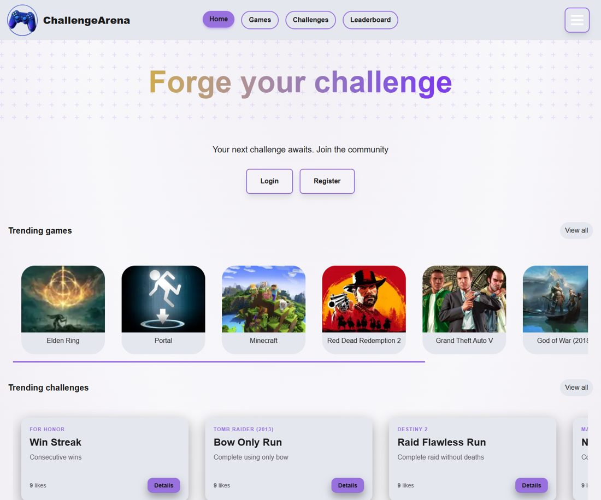
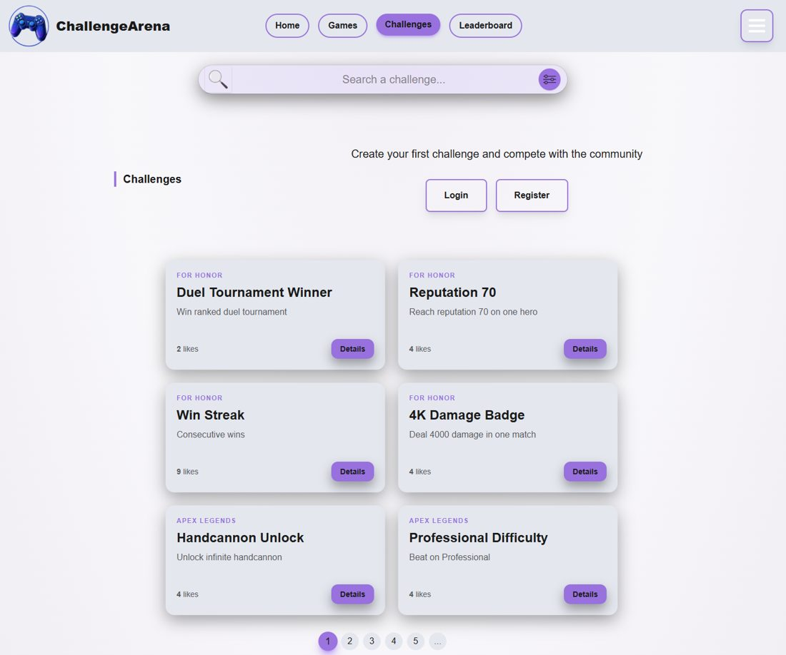
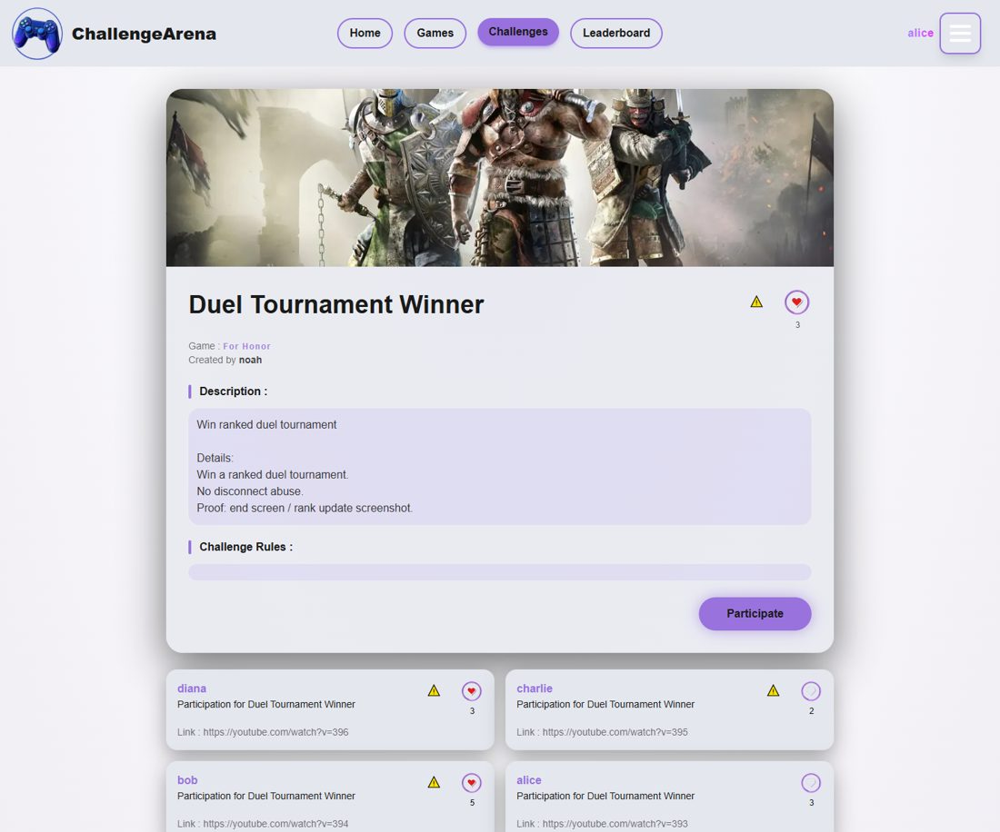
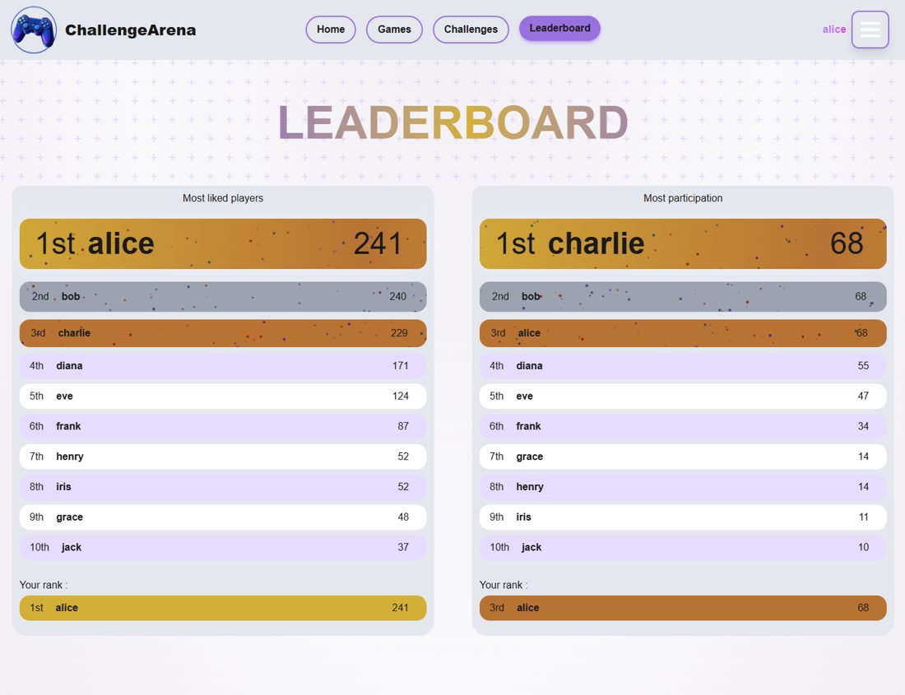
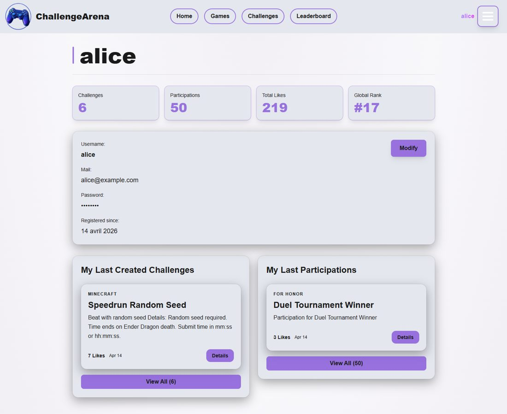

# ChallengeArena

[](https://github.com/RomainLocatelli/challenge-arena/actions/workflows/ci.yml)

Plateforme communautaire de défis de jeux vidéo : les joueurs créent des challenges sur n'importe quel jeu, soumettent leurs performances en vidéo et votent pour les meilleures.

Projet de fin de formation **Concepteur Développeur d'Applications** (titre RNCP niveau 6) à l'école O'clock, réalisé en équipe de 4 en janvier 2026, puis fiabilisé et industrialisé en autonomie.



## Fonctionnalités

- Inscription, connexion et déconnexion (JWT en cookie httpOnly)
- Création, modification et suppression de challenges, avec contrôle d'ownership
- Recherche de jeux par autocomplétion via l'API RAWG (plus de 500 000 titres), appelée côté serveur pour ne jamais exposer la clé
- Participations par lien vidéo (YouTube, Twitch) et double système de vote : challenges et participations, un vote par utilisateur garanti en base
- Classement des joueurs les plus votés et les plus actifs
- Profil avec statistiques, modification du compte et suppression avec anonymisation (RGPD)
- Signalements et espace de modération : validation, bannissement, gestion des rôles
- Interface responsive avec mode clair / sombre

## Stack technique

| Couche | Technologies |
|---|---|
| Front-end | Next.js 16 (SSR / ISR), React 19, TypeScript, Tailwind CSS 4 |
| Back-end | Node.js, Express 5, TypeScript, Zod 4 |
| Base de données | PostgreSQL 18, Prisma 7 (ORM, migrations, seed) |
| Sécurité | JWT httpOnly, Argon2, Helmet, CORS, protection CSRF (vérification de l'origine), validation Zod |
| Tests | Vitest, Supertest, fuzzing, tests de charge (autocannon) |
| DevOps | Docker / Docker Compose, Dockerfile de production multi-stage, GitHub Actions |

## Architecture

```
┌──────────────┐   HTTP + cookie   ┌──────────────┐   Prisma   ┌──────────────┐
│   Next.js    │ ────────────────▶ │ API Express  │ ─────────▶ │  PostgreSQL  │
│  (client/)   │                   │   (api/)     │            │              │
└──────────────┘                   └──────┬───────┘            └──────────────┘
                                          │ proxy serveur
                                          ▼
                                   ┌──────────────┐
                                   │   API RAWG   │
                                   └──────────────┘
```

L'API suit une organisation en couches : `routes` → `middlewares` (protection CSRF, authentification, rôles, validation Zod) → `controllers` → `services` → Prisma. Les erreurs sont centralisées dans un gestionnaire unique qui distingue les erreurs métier (400, 401, 403, 404, 409) des erreurs serveur.

## Qualité et tests

La suite automatisée compte **93 tests** répartis sur 8 fichiers. Les tests d'intégration s'exécutent sur une base PostgreSQL de test isolée et réinitialisée avant chaque test.

| Fichier | Tests | Périmètre |
|---|---|---|
| `participations.test.ts` | 18 | Participations et votes |
| `challenges.test.ts` | 17 | CRUD, ownership, doublons |
| `profile.test.ts` | 13 | Consultation, modification, suppression, anonymisation |
| `moderation.test.ts` | 13 | Validation, bannissement, rôles |
| `fuzzing-login.test.ts` | 12 | Injection SQL, XSS, JSON malformé, types incorrects |
| `csrf.test.ts` | 8 | Origine autorisée, étrangère ou `null`, repli sur le Referer, branchement sur l'API |
| `auth.test.ts` | 6 | Inscription, connexion, session |
| `reports.test.ts` | 6 | Signalements |

Ces tests ont permis de détecter et corriger trois bugs réels, chacun renvoyant une erreur 500 au lieu du bon code : JSON malformé (400), erreurs de validation Zod hors middleware (400) et titre de challenge en double (409).

**Protection CSRF.** En production, le cookie d'authentification est en `sameSite: 'none'` pour fonctionner entre deux domaines, ce qui l'expose aux attaques CSRF (point relevé par le jury du titre CDA). Un middleware vérifie désormais l'en-tête `Origin` (repli sur `Referer`) de chaque requête POST, PUT, PATCH et DELETE, et renvoie 403 si elle ne vient pas du front-end, comme le recommande l'OWASP.

La CI GitHub Actions rejoue à chaque push et pull request : installation, lint, génération du client Prisma, migrations, build TypeScript et tests.

## Lancer le projet en local

**Prérequis** : Docker et Docker Compose, Node.js 24+, une clé gratuite de l'[API RAWG](https://rawg.io/apidocs).

1. Cloner le dépôt :

   ```bash
   git clone https://github.com/RomainLocatelli/challenge-arena.git
   cd challenge-arena
   ```

2. Créer le fichier d'environnement à partir du modèle, puis le remplir :

   ```bash
   cp ".env example" .env
   ```

   Pour générer un `JWT_SECRET` :

   ```bash
   node -e "console.log(require('crypto').randomBytes(64).toString('hex'))"
   ```

3. Lancer les conteneurs (API, client, base de développement et base de test) :

   ```bash
   docker compose up --build
   ```

   Les migrations s'appliquent au démarrage de l'API.

4. Charger les données de démonstration :

   ```bash
   docker compose exec api npm run seed
   ```

| Service | Adresse |
|---|---|
| Front-end | http://localhost:8008 |
| API | http://localhost:3000 |
| Base de développement | localhost:5433 |
| Base de test | localhost:5434 |

### Lancer les tests

Avec la base de test démarrée et `DATABASE_URL_TEST` renseignée dans `.env` :

```bash
cd api
npm ci
npm test
```

## Captures d'écran

| Liste des challenges | Détail d'un challenge |
|---|---|
|  |  |

| Classement | Profil |
|---|---|
|  |  |

## Équipe et contributions

Projet réalisé en janvier 2026 par Quentin Caffray, Mickaël Levasseur, Loup Kurtz et Romain Locatelli, en 4 sprints agiles : un sprint de conception (user stories, modèle de données, maquettes, diagrammes UML), puis trois sprints de développement.

**Ma contribution (Romain Locatelli)**

- *En équipe* : principal contributeur du back-end. Mise en place du projet (structure, Prisma, Docker, middlewares), endpoints jeux, challenges, classement et profil, proxy RAWG, système de modération, suppression avec anonymisation, seed de données. Côté front : autocomplétion des jeux, pages Aide et À propos, composant `ChallengeCard`.
- *En autonomie (août 2026)* : écriture des tests automatisés et des cas de fuzzing, correction des bugs détectés, protection CSRF, Dockerfile de production multi-stage, pipeline CI GitHub Actions, déploiement et tests de charge.

## Pistes d'amélioration

- Limitation du nombre de tentatives de connexion (rate limiting)
- Notifications, abonnements à des joueurs ou à des jeux
- Internationalisation
